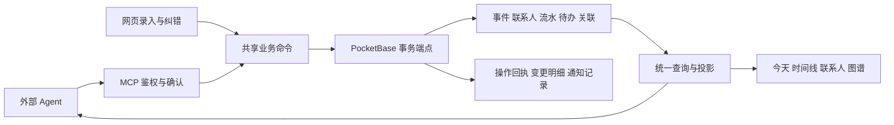

# 寻鸽个人助手完整改造规划

规划日期：2026 年 11 月 11 日。

产品定位：以自然语言为主要输入，以事件和联系人组织个人记忆，用时间线回顾经历、用图谱理解联系，用待办承接承诺、用财务保存收支事实。

本轮目标：用户向任意已接入的 Agent 讲述一件事，系统能完整记录、准确关联、可靠重试；随后可以查询、解释和纠正，网页中的时间线、图谱、联系人、待办和财务展示同一组事实。

本方案重新确定产品范围和实施顺序，替代原文档中团队协作定位、阶段划分及与本目标冲突的功能优先级。现有历史记录保留。本文保留已批准的规划与阶段边界；编制时尚未执行代码、迁移和部署。当前实施与验收事实统一见 docs/PROGRESS.md，不以规划中的将来时判断完成情况。

## 一 产品范围与主要决策

| 决策 | 本轮采用的方向 | 理由与代价 |
| --- | --- | --- |
| 使用者 | 一位拥有者，多设备、多个获授权的 Agent 客户端 | 取消团队协作流程；保留登录、设备授权、撤销授权和备份 |
| 主要输入 | 外部 Agent 理解自然语言，调用结构化业务工具 | 复用用户已有的模型与客户端；项目无需维护第二套聊天模型和密钥管理 |
| 主要输出 | Agent 查询回答，以及今天、时间线、联系人、图谱 | 查询和解释与录入同等重要 |
| 核心对象 | 事件、联系人、操作记录；关联待办、流水、笔记和附件 | 一次讲述形成一个可追溯整体，专业数据继续有清晰归属 |
| 数据中心 | 自托管 PocketBase | 沿用现有部署和数据主权；重点修复事务、查询、备份与认证边界 |
| Web | 服务端提交成功后更新本地缓存 | 缓存可重建，失败必须可见，保存结果必须可信 |
| 原生端 | 本轮保持在线业务兼容，离线支持限定为草稿捕获 | 完整离线复合写入增加同步冲突成本；已有离线数据必须先盘点和迁移，不能直接丢弃 |
| 存储方式 | 关系型业务实体加轻量操作历史 | 维持当前状态查询的简单性；不引入全量事件溯源、消息中间件或图数据库 |
| 图谱与时间线 | 核心视图，复用现有实现并扩展事件表达 | 优化筛选、证据和穿透能力，保留已有布局与视觉资产 |
| 兼容方式 | 新业务命令为核心，旧工具名和旧实体 ID 分阶段兼容 | 避免已有 Agent 配置、深链和数据关联一次性失效 |

第一轮必须交付可靠记录、完整查询、事件关联、可追溯纠错和两个核心视图。自动语音转写、OCR、邮箱日历导入、向量检索、复杂应收应付、团队权限、新原生平台、新主题均列为后续独立需求。

## 二 完整用户体验

### 一次讲述形成一组关联记录

用户说：今天和小王聊了网站改版，收到尾款 2000 元，答应周五发第二版方案。

系统应完成以下流程：

1. Agent 提取一个沟通事件、一笔已发生收入和一项未来承诺。
2. 根据姓名、别名和上下文查找联系人。只有候选不唯一或关键事实缺失时才询问。
3. 解释相对日期，标明所用日期与时区；有歧义时不猜。
4. 返回一份覆盖整组变更的预览，按既有风险分级取得所需确认。
5. 原子提交事件、流水、待办、关联和操作回执。
6. Agent 回答已记录的内容，并给出可打开的事件链接。
7. 时间线显示一次沟通及关联结果，图谱连接联系人、事件、流水和承诺；财务只统计那一笔流水。

这段话里的收款必须来自用户明确陈述。仅说开了发票、报价 2000 或预计到账，都不能直接创建已发生收入。

### 查询可以追溯到原始记录

| 用户表达 | 期望结果 |
| --- | --- |
| 我今天做了什么 | 当天事件，包含无联系人的独立工作；计划中与已发生分开展示 |
| 上次和小王聊了什么 | 最近相关沟通内容、发生日期和原始事件链接 |
| 我还答应了他什么没做 | 与联系人有关、仍未完成的承诺，以及承诺来源 |
| 这个月收了多少钱 | 按币种计算的全量收入汇总，明确时间范围和对账口径 |
| 小王是通过谁认识的 | 有证据的联系人关系与来源事件；缺证据时明确未记录 |
| 网站改版后来进展怎样 | 同一事项下的事件、待办变化和相关收支，按时间组织 |

### 纠错作用于明确的记录

用户说金额应为 1800 时，Agent 应定位到上一笔操作中的流水，展示 2000 改为 1800 的差异，再按风险规则提交。原始讲述作为来源保留，当前金额以修正后的流水为准。

用户说刚才说错了，是老王时，系统需要预览哪些联系人关联将改变。已经独立修改的待办、已经核对的流水等不能被粗暴覆盖。

撤销一组录入只撤销该操作创建或修改的对象。已经被后续操作使用或修改的对象要返回具体冲突，允许用户选择修正范围。修正、撤销、删除记录和真实退款是不同操作，不相互自动替代。

## 三 数据模型与单一事实来源

### 业务对象的职责

| 对象 | 保存的权威事实 | 不承担的职责 |
| --- | --- | --- |
| 联系人 | 身份、别名、联系方式、标签及明确关系 | 不强制要求公司或商务角色 |
| 事件 activities | 一次实际发生的经历、沟通或进展，及发生时间 | 不重复保存可用于财务统计的第二份金额 |
| 事项 projects | 跨多次事件的工作主题，包含稳定 ID、名称、可选别名和相关联系人 | 不要求引入复杂项目管理、排期或团队角色 |
| 流水 transactions | 金额、币种、方向、发生日期、对账状态 | 不因出现在多个联系人视图而被重复累计 |
| 待办 todos | 未来承诺、截止日期、执行状态 | 不把未来计划当作已经发生的经历 |
| 笔记 notes | 长文、资料和整理后的内容 | 不作为所有事件的无结构兜底库 |
| 关联 links | 谁参与了什么、何种关系、来源证据 | 不承载第二套实体状态和金额 |
| 操作 operations | 一次录入、修改或撤销的身份、来源、请求指纹、状态和结果 | 不保存完整模型对话、隐私密钥或模型内部推理 |
| 变更明细 operation_effects | 某次操作改变了哪些对象、前后版本和必要差异 | 不要求回放全部历史才能读取当前状态 |

业务事件与技术通知分开：activities 表达用户经历；现有 eventBus 和 agent_events 用于通知与跨端刷新，不充当完整个人记忆。

建议新增 activities、operations、operation_effects 三个集合，扩展现有联系人字段和 links 端点。每个集合都要有独立用途、索引、迁移版本、保留策略和恢复测试。先在隔离 PocketBase 中验证，再升级持久数据。

### 事件的最小字段

| 字段 | 语义 |
| --- | --- |
| id | 稳定事件 ID，界面和工具共用 |
| title 与 summary | 简明主题和当前事实摘要；金额、待办状态等展示从关联实体取值 |
| occurredAt 与 occurredUntil | 实际发生时间或时间范围 |
| timePrecision | 日期、分钟或时间范围；只有日期时不虚构具体钟点 |
| timeZone | 解析原始表达时使用的 IANA 时区 |
| recordedAt | 首次录入时间，补记不会改成发生时间 |
| category 与 tags | 小规模可筛选分类和标签，允许未分类 |
| sourceOperationId | 对应的录入来源和操作回执 |
| revision 与删除元数据 | 并发控制、回收站和版本追溯 |

联系人、项目、流水、待办、笔记和附件通过 links 关联事件。一个事件可有多个联系人，也可完全没有联系人。一次讲述可拆成多个事件，使用同一个 operationId 关联；不能为了凑一条记录把不同日期的经历揉成一个事件。

事件修改只更新明确指定的事实。事件的普通删除保留独立财务记录，默认解除关联；整组撤销则按照操作明细检查依赖后处理，二者使用不同入口和说明。

跨多天的工作主题沿用现有 projects 作为可选事项容器，例如网站改版或搬家。事件可关联事项，但普通记录无需先建项目；预算等已有字段保留，不作为个人记录的必填项。

事项按明确 ID、名称和别名消解。同名事项不自动合并，创建新事项进入整体预览；不能临时用一个标签代替事项身份。延期、重新打开和完成已有承诺时修改原待办，同时留下状态变化记录，不重新创建一项同名承诺。

统一事件流是查询投影：用户经历来自 activities；新待办的完成、作废等变化来自已提交的 operation_effects；尚未归入事件的流水和旧沟通通过历史适配器展示。每项携带来源类型、稳定来源键和对象链接，迁移后的来源键只展示一次。这样既能保留原始经历和后续执行历史，也不用复制流水金额或制造第二份待办状态。

### 联系人模型

界面和新工具使用联系人概念，第一轮保留现有 customers 存储名及 ID，降低迁移范围。旧工具通过兼容层映射。

- 姓名是最小必填项；公司、职位、决策角色转为可选商务资料。
- 增加别名、称呼和可选类型。旧记录不能仅凭名字被自动判定为个人或机构，无法确定时保留未指定。
- 搜索先做精确身份匹配，再做别名与模糊匹配；返回命中依据和有限候选。电话等识别信息仅按需要展示。
- 联系人合并要有预览，列出待迁移的事件、流水、待办和关系；使用版本校验并记录合并来源。
- 历史客户关系保留，来源标为历史记录。没有来源事件时不能补造证据。
- 联系人删除不默认删除其经历、流水和承诺；可解除身份关联并保留事实。彻底移除个人信息使用独立的数据清理流程。

### 金额和时间规则

新写入金额采用最小货币单位整数并使用明确的字段名，现有 amount 字段通过迁移转换，不原地改变同名字段含义。当前支持的 CNY、USD、EUR 都按分处理；发现超出两位小数的旧记录时列出异常，不静默舍入。API 输入输出同时注明单位。

币种随流水固定，防止修改账本币种重新解释历史金额。已有流水的账本更换币种需要显式迁移或新建账本。汇总按币种分组，第一轮不引入汇率折算。

对账状态只表示是否核对，不表示是否到账；收入、支出记录明确已发生的收支。未到账承诺先记录为事件或待办。当前 CRM 的待回收款改为待核对收入。

相对时间以用户配置时区和该次讲述的参照时间解释；初始时区采用 Asia/Shanghai。昨天与周五的解析结果必须进入预览，重试沿用已解析的时间，不随跨日变化。截止日期和事实发生时间分别保存。

## 四 服务端提交架构

### 事务方案选择

| 方案 | 优点 | 成本和限制 | 用途 |
| --- | --- | --- | --- |
| PocketBase 批量事务 API | 同批记录可原子提交，接入范围较小 | 复杂跨记录校验、并发版本检查及完整操作回执仍需额外设计 | 可用于明确写集合的简单操作与迁移 |
| PocketBase 业务事务端点 | 校验、读写、幂等回执可在一个数据库事务中完成 | 需要维护少量服务端入口及 JSVM 兼容构建 | 推荐用于复合录入、纠错、撤销、联系人合并 |
| Node 逐条请求加补偿 | 改动表面较小 | 进程中断、补偿失败和并发编辑会留下不确定状态 | 不作为核心业务提交保证 |

推荐将核心复合操作放入 PocketBase 的业务事务端点，继续使用已有 Node relay 做协议、授权和命令转接。Node 进程执行多次 HTTP 请求不能被描述为数据库事务。

当前镜像固定 PocketBase 0.40.2。开工先用这个版本验证事务、文件处理、认证中间件及失败回滚，不能用最新文档直接代替版本验证。官方文档已提供 [事务机制](https://pocketbase.io/docs/js-database/#transaction)、[自定义认证路由](https://pocketbase.io/docs/js-routing/) 和 [批量记录事务](https://pocketbase.io/docs/api-records/#batch-createupdateupsertdelete-records)；能力验证结果决定具体接口实现，不先升级数据库版本来绕过问题。

### 共享规则与宿主边界

- 共享业务核心采用纯 TypeScript 数据结构和函数，负责参数、时间、金额、关联选择、变更计划与错误码。
- Node、浏览器和 PocketBase 的宿主层分别负责 I/O。不能把当前异步 StorageTx 回调原样塞进 PocketBase JSVM。
- 在技术验证阶段证明共享核心可编译成 JSVM 支持的代码；禁止依赖 Node、React、Dexie 或未经验证的运行时能力。
- 服务端在事务内重新读取记录并校验版本、引用和权限；不能信任 Agent 传来的校验结果，也不能只信预览时的快照。
- 自定义路由显式要求正确的个人账号身份并校验业务范围；数据库内部保存不会自动替代访问控制。
- UI 与新旧 MCP 工具调用同一套业务命令。旧 repository 中的复合逻辑逐项迁入共享规则，避免另写一套同名业务。
- 所有在线写入口都要纳入清单；只改新录入工具、仍允许旧适配器绕过命令直接写库，不算完成迁移。

### 原子提交与回执

一次复合提交应在同一个事务中完成：身份与版本检查、请求去重、业务记录、关联、操作回执、必要变更明细和持久通知记录。成功响应只在提交完成后返回。

操作状态至少包含 draft、awaiting_confirmation、committed、cancelled。校验冲突和请求失败以明确错误码返回，不把暂时错误写成已完成；客户端可以通过稳定请求标识查询是否已经提交。

请求标识在第一次提交前确定，并在同一次重试中复用；数据库对拥有者与请求标识建立唯一约束。同标识不同参数必须拒绝。同内容的第二次真实事件可以使用新标识，不能仅按文本相同自动去重。

不同 Agent 重述同一事实通常有不同请求标识，技术幂等不能直接判定两者相同。预览可按金额、币种、联系人、发生时间等返回疑似重复证据，允许选择关联已有记录或明确新增；相似文本不自动删除或吞掉真实的第二次事件。

超时不代表失败。Agent 先查操作状态：已提交则返回既有回执；未提交才能用原标识重试。幂等结果必须在业务事务内持久化，不能只放在 relay 内存里。

### 预览与确认

同一讲述的多项动作形成一个结构化预览，绑定联系人 ID、动作、金额、日期、目标版本和规范化参数指纹。风险取整组动作中的最高等级。

确认后参数、目标或影响范围改变，要生成新预览和票据。既有中高风险确认边界继续生效；个人项目定位不等于取消确认。

为了处理票据已消费但响应丢失，重复请求先按身份、请求标识与参数指纹查询已提交回执。已经完成的同一操作可返回原结果，不重复执行；没有提交结果时按票据状态决定重新确认。两次并发确认不得提交两次。

### 附件和通知

附件采用受控暂存，上传成功后在业务事务中关联暂存资源。失败不得留下可见的半条流水；未使用暂存文件按期限清理。数据库记录与文件系统的崩溃一致性要单独验证，不能把数据库事务成功等同于所有文件都可靠落盘。

通知只用于提示客户端刷新。业务事实和通知的可投递记录同时提交，提交后发送；发送失败可重试。已有 agent_events 可评估复用为通知投递记录，不能因此把它当作 activities 的替代品。

通知允许重复投递，客户端按事件 ID 和记录版本幂等消费；奖杯、经验等辅助能力不得因重投重复奖励。重启后补发不能依赖进程内存里尚未执行的回调。

## 五 Agent 工具重组

目标是减少 Agent 自行拼接多个 CRUD 调用的负担，同时保留精确查询和修改能力。以下名称为建议接口，不要求一次性替换旧工具名。

| 工具 | 主要职责 | 关键限制 |
| --- | --- | --- |
| resolve_contacts | 姓名、别名、身份线索查找联系人 | 候选限幅，返回理由，歧义不能直接写关联 |
| resolve_topics | 查找已有事项，或准备在整体预览内新建事项 | 同名返回候选，名称与标签不等同于稳定身份 |
| preview_capture | 校验结构化讲述，生成事件与后续动作的整体预览 | 原话作为数据；不接收任意代码、SQL 或未知动作 |
| commit_capture | 按确认策略原子保存一组记录 | 参数指纹、版本、请求标识、回执去重 |
| get_operation | 查询一次操作的结果和对象链接 | 不泄漏其他设备凭据或完整对话 |
| search_activities | 按时间、联系人、事项、关键词查询事实 | 游标分页、有限摘要、可选字段 |
| get_activity | 读取一个事件、关联结果和来源片段 | 长正文和附件按需读取，返回截断信息 |
| get_contact_context | 联系人近况、最近事件、未完成承诺、相关收支摘要 | 每类限制数量，完整汇总单独计算 |
| query_tasks | 按截止时间、状态、联系人和来源查询承诺 | 区分无日期、今日、逾期；分页可继续，未完成不包含作废 |
| query_finance | 在明确范围内汇总和查询流水 | 全量匹配集合计算，按币种分组，不对截断列表求总数 |
| get_record | 按类型读取一条待办、流水或笔记的必要详情 | 正文采用显式字段选择和长度上限，长文可分段继续读取 |
| query_graph | 查询一跳或有限二跳关系及证据 | 深度、节点、边数上限，显式返回截断与继续查询方式 |
| preview_amend 与 commit_amend | 修正已存在的事实或关联 | 返回前后差异、版本冲突和影响范围 |
| preview_undo 与 commit_undo | 撤销一次录入的可撤销部分 | 检查后续依赖，禁止无条件覆盖后续修改 |

工具分组按发现机制或文档组织，不假设所有 MCP 客户端都支持按需动态加载。第一轮提供稳定工具目录，避免工具清单频繁变化让已连接客户端缓存失效。

旧 fin_recordTransaction、crm_addInteraction、todo_createTodo 等入口保留兼容路由，逐步接入相同幂等、校验和提交核心。旧无请求标识调用只能明确标注不可安全自动重试，不能假装已经具备幂等；新客户端必须发送稳定标识。

工具说明应区分讲述的事实、计划和推测。项目名称、备注、原话、附件文本均是内容，不得被解释为修改权限或执行其他工具的命令。

回答应包含数据范围和依据。例如本月收入按币种列出，说明是否包含未核对流水，并链接到对应筛选视图。日期解析失败、超过查询范围或历史资料不足，都返回可操作状态，避免用空列表代替错误。

事件查询共用统一事件流投影，返回来源类型以区分经历、执行变化和历史记录。分页采用确定性的时间与 ID 排序，游标绑定筛选条件和查询截止点；无法维持原查询快照时明确返回需要刷新，避免静默漏项。金额汇总在同一明确数据范围内计算，不能拼接不同时点的分页结果。原文、笔记正文和附件提取内容都按需读取，列表摘要不携带全量正文。

## 六 核心视图和页面结构

### 导航与今天页

桌面主导航采用今天、时间线、联系人、图谱；待办、财务、笔记作为相邻功能入口，设置、数据管理和辅助能力收在次级区。

手机底栏建议今天、时间线、联系人、图谱、更多。今天页直接提供待办、记收支和快速记录入口，保证日常执行不需要穿越多层菜单。习惯、奖杯、专注从更多或可配置的小卡进入。

今天页围绕以下内容组织：今天发生的事、今天要兑现的承诺、需要核对的收支、最近录入与待确认事项。区分实际发生与计划，删去没有行动价值的营销指标。

网页保留轻量手动表单和原话草稿入口；本轮不建设第二套完整聊天界面。草稿未提交时明确显示未记入正式数据。

### 时间线

- 第一层是个人全局时间线，包含有无联系人两类事件。
- 可按联系人、事项、类别、时间范围和来源筛选，筛选结果有稳定链接，Agent 可直接引用。
- 一次录入中的沟通、收支和承诺采用可展开组；同一笔流水只保留一个权威对象。
- 新发生的待办完成、作废等动作保留可查询的变化时间，不能通过移动原始条目抹掉先前经历。
- 历史待办只展示已有可靠时间，不补造缺失的创建或完成过程。
- 日期不完整时按精度显示，并采用确定性排序，避免把只有日期的记录显示成精确的凌晨事件。
- 每条事件可打开关联对象、查看来源和修改记录；纠错入口就在事件详情内。
- 使用分页或虚拟化作为性能手段，先定义查询接口和规模指标，再选择具体实现。

### 图谱

保留现有联系人关系图，增加以事件为连接中心的视图。同一图中实体 ID 唯一，事件连接多个联系人时不能复制成多个独立事件。

| 模式 | 回答的问题 | 默认范围 |
| --- | --- | --- |
| 联系人关系 | 我和这个人、他与其他人是什么关系 | 焦点联系人及一跳邻居 |
| 事件关联 | 这件事涉及谁、什么承诺和收支 | 单事件及其直接关联 |
| 事项进展 | 一组相关事件如何形成工作进展 | 选定事项与时间范围 |

明确关系、共同参与、财务关联使用不同边语义。共同参与一个事件不自动生成长期社交关系。关系边可点击查看来源事件和原话依据；历史无依据关系标注为历史录入。

图谱和时间线互相定位：时间线打开事件图，图谱节点打开时间线片段。财务金额标签沿用币种规则；图谱中出现多个关联不能改变财务统计。

默认限制节点和边，提供扩大范围、时间筛选和聚焦，不默认加载全部历史。键盘可访问的列表或关系详情是图形视图的替代入口。

### 联系人和业务页面

联系人详情采用近期事件、未完成承诺、相关收支、关系和资料五类内容；支持直接记录与该联系人的经历。健康分降为可选辅助信息，关系事实和最近互动优先。

财务页面统一统计口径，接通首页记一笔、防重复提交、清空字段和错误提示；删除及修正都显示影响范围。待办显示承诺来源、关联联系人和事项，完成后可以回到来源事件。

设置合并为账号与设备、Agent 接入、外观、数据与备份、关于。撤下未实现的加密、同步频率和通知控件；实际已有的提醒能力用准确文案说明。

团队工作区切换、成员邀请、团队角色和协同通知从产品流程移除。旧 workspaceId 若被用作 ID 前缀或数据兼容键，先固定在内部保留；确认无消费者后再迁移，避免仅为改名破坏历史 ID。

## 七 既有缺陷的整改归属

| 已确认问题或风险 | 本轮处理方式 | 完成证据 |
| --- | --- | --- |
| Web 和服务端适配器逐条写入形成半成功 | 核心动作改走业务事务端点 | 第 N 步故障后业务数据零部分提交 |
| 连点及网络重试重复记账 | 提交锁加持久幂等回执 | 连点、超时、并发重试均只有一笔 |
| 多联系人导致金额重复、跨币种裸加 | 统一财务查询及按 ID 去重 | 单流水多关联总额不变，CNY 与 USD 分列 |
| 清空字段被省略、写冲突假成功 | 显式清空语义和版本冲突返回 | 清空后刷新及换设备仍为空，冲突保留输入 |
| 回收站在对齐后消失 | 拆开归一化与增量合并策略，镜像保留可恢复删除记录 | 刷新、周期更新、新设备可按保留策略恢复 |
| 永久删除后被旧设备复活 | 保留最小删除登记并拒绝旧记录重建 | 旧离线副本恢复网络也不能复活 |
| relay 连接异常导致站点进程退出 | 连接错误隔离、资源上限、认证时限 | 异常连接结束，其他连接及健康检查正常 |
| 多标签页桥失去执行端 | 服务端为默认执行路径，浏览器桥有明确活动连接管理 | 关闭任意页面不影响服务端录入 |
| 首启并发、注册规则靠手工、认证故障放行 | 初始化原子化，规则幂等固化，生产认证失败关闭访问 | 空库并发只建一账号，故障页可重试 |
| 长期 token 共用与查询串日志风险 | 规划按客户端管理凭据、脱敏日志和撤销授权 | 单独撤销一个 Agent 后其他客户端仍可用 |
| 同长度入口沿用旧 ETag | 内容指纹或版本标识缓存策略 | 新内容同长度也能被已有客户端获取 |
| 备份缺库仍成功、恢复说明失配 | 可验证备份、成功后再清理、隔离恢复演练 | 恢复后记录、金额、关联、附件核对通过 |
| 默认账本开关和不存在记录加载状态错误 | 精确修正字段更新及查询状态 | 修改可持久化，不存在记录给明确空态 |
| Agent 可写沟通但缺读回，列表截断不能计算完整总额 | 增事件查询、详情和服务端汇总 | 可回答上次沟通及超过一页的月度统计 |

以上结论来自当前代码 04218ca 的静态审查与隔离测试；当前正式站是否部署同一版本，以及实际账号、备份和凭据配置，进入部署阶段另行核验。

## 八 同步 离线与权限边界

### 在线一致性

服务端为权威状态。Web 本地缓存按变更增量更新，未改变的记录不反复删除重建。提交响应先更新相关对象，再通过带游标的服务端查询补齐其他变化；后台刷新不得覆盖刚提交的更高版本。

建议先保留有界轮询完成正确性，再评估 PocketBase 实时通知。通知只表示有变化，客户端仍从权威查询接口取数据。全量对齐作为修复和首启路径，必须有互斥控制、失败状态和完成游标。

财务和复合操作使用显式版本冲突，不把客户端时间戳当作唯一裁决依据。联系人别名等可合并字段也要有明确合并规则，不能对全部字段套同一个最后写入胜出策略。

永久删除后保留不包含业务正文的最小删除登记，用于拒绝旧 ID 重建。需要清理登记时，同时采用客户端同步世代或最低同步水位：过期客户端必须全量重建，再接收它的新操作。仅保留固定 30 天并不能保证任意长离线设备不复活记录。

### 原生端过渡

第一轮将完整离线复合写入列为延后能力，保留离线原话草稿和只读缓存。上线前必须列出用户实际使用的客户端、版本和未同步队列。

现有离线数据先导出和核对，再通过兼容入口或迁移工具导入；不得清空队列后声称迁移完成。尚未适配的新协议客户端进入明确只读或待升级状态，不能继续用旧的逐表推送写坏新事实。

限制必须由服务端落实：切换后拒绝旧写协议和未纳入命令事务的集合直写入口，不能依赖旧客户端主动识别升级提示。对应关闭普通账号的绕行写权限时，必须先验证新业务端点的身份、范围和输入校验；备份管理等超管流程保持独立。

如必须恢复完整离线编辑，作为后续项目实现持久操作队列、相同 requestId 重放和服务端版本冲突；待服务端确认后才标为已入账。客户端与服务端保持相同业务命令，而不是恢复第二套写库口径。

### 个人账号与 Agent 授权

一位拥有者可授权多个客户端。建议每个客户端有可命名、可撤销的凭据，保存散列和最小能力范围；已配对的共享 token 需要有受控过渡期和明确失效策略。

确认票据绑定客户端、操作、参数指纹和到期时间。relay 保持协议与授权职责，业务事实由受保护的业务命令端点处理。凭据不进入 URL 日志、操作原话、导出或错误回包。

用户原话和长期记录允许主动删除。操作追溯的保留范围与隐私清理一致：彻底移除资料时同步处理活动、操作来源片段和附件，不能通过审计历史重新暴露已清理内容；最小删除登记只保留防复活所需标识。

清理范围还包括 operation_effects 的旧值和差异、operations 的结果快照，以及相关搜索缓存。共享原话包含多件事时应支持按范围脱敏，不误删其他仍需保留的事实。清理后重试旧请求只返回已执行且相关内容已清理的最小回执；涉及已清理内容的撤销返回不可恢复原因，不能借撤销重建私人资料。

在线数据清理立即生效，备份副本按明确保留期淘汰。清理登记需在备份恢复链之外受保护地保存；恢复后先重放清理登记再开放访问。登记不可用时，恢复环境保持隔离并核对清理范围，不能承诺恢复旧备份后仍自动保持所有清理结果。

## 九 数据迁移与上线

### 迁移原则

采用增加新结构、验证、切换写入口、切换读入口、最后清理的顺序。第一轮不删除旧集合和旧字段，直到新路径稳定且回退窗口关闭。

迁移程序有版本号、检查点、预演模式和对账报告，可中断续跑且重复运行不新增记录。每条新记录保留来源表与来源 ID；来源映射建立唯一约束。

### 历史数据映射

| 旧数据 | 新模型中的处理 |
| --- | --- |
| customers | 保持 ID 和现有数据，增加可选别名及个人联系人展示 |
| interactions | 按来源 ID 确定性生成历史事件，保留 at 和 content；不猜同日多条属于同一次会面 |
| transactions | 继续作为财务真源，生成确定性来源关联；尚无事件的流水可由时间线适配投影展示 |
| todos | 保留当前状态和已有可信日期；未来承诺关联来源事件，未知来源标为历史记录 |
| notes 和附件 | 保留原内容及引用，逐步允许挂到事件 |
| links | 扩展活动端点和证据来源，保留旧语义；按唯一实体 ID 构建图谱 |
| workspace 与角色 | 内部兼容字段暂留，用户流程撤下团队含义 |
| agent_events | 延续技术通知职责，不自动冒充完整历史事件 |

历史投影与已迁移活动以确定性的来源键合并，禁止把旧流水和新事件再次显示为两笔独立收支。尚无可靠来源的一组记录保持独立，人工或 Agent 经确认后再建立联系。

沟通数据切换后，activities 成为唯一可编辑正文来源。旧 interaction ID 通过来源映射解析到活动，旧沟通写工具改走活动命令，兼容读取从活动生成投影。原 interactions 表冻结为迁移来源，不持续双写两份正文。回收站、搜索、联系人最近互动统计等所有消费者都要同步切换。

保留旧界面读能力是指新版中的兼容视图和旧深链解析，不承诺任意历史安装包都能正确理解新结构。旧二进制的访问范围依服务端兼容策略控制。

操作历史从新命令切换时开始完整记录。旧数据只有实际已知内容，不能补造原话、操作人、确认过程或不存在的修订历史。

### 发布步骤

1. 盘点正式数据、客户端版本、队列和附件，验证一份可恢复备份。
2. 在临时自托管容器中用脱敏副本执行完整迁移，核对金额与关联。
3. 部署兼容新旧数据结构的后端，先关闭新写入入口，执行新增 schema 和索引。
4. 完成可重复迁移，对账通过后开放新查询，保留旧界面读能力。
5. 在可控维护窗口切换所有在线写入口；升级或限制旧客户端写入。
6. 启用新 Agent 工具和兼容路由，确认页面关闭时仍能读写。
7. 上线时间线和图谱新投影，检查深链、缓存和多端刷新。
8. 观察错误、冲突和备份结果；达到稳定条件后再另行清理兼容字段和旧代码。

切换新写入前可回到旧读写模式；新写入开始后，回退必须保留新结构并使用兼容版本。不能直接恢复旧备份覆盖切换后新增记录。确需数据级回退时，先停止写入、导出新增操作并制定重放方案。

### 恢复后继续使用

服务端维护数据世代标识，客户端游标、操作请求和确认票据绑定该标识。恢复较早备份时生成新世代，废止旧游标与票据；客户端先保护未提交草稿，再重新建立缓存。

备份恢复点之后曾经成功的请求，其回执可能已不在恢复库中。跨世代的旧请求查不到回执时返回恢复后待核对，不能当作普通失败自动再执行。恢复工具应合并可用的新操作日志和删除登记，并将无法确认的条目交给用户核对；确认重录时产生新的受控操作。

恢复演练必须包含仍保持打开的浏览器、持有旧请求的 Agent 和旧离线设备，验证它们不能用旧游标、票据或写入重新污染恢复后的数据。

## 十 实施阶段与交付物

工作量采用 S、M、L 相对估算：S 为局部修改，M 涉及多个模块，L 涉及数据协议、迁移或跨端一致性。完成阶段一的技术验证后再给日历排期，避免把未知迁移成本伪装成确定工期。

| 阶段 | 工作与交付物 | 依赖 | 规模 | 放行标准 |
| --- | --- | --- | --- | --- |
| 阶段一 技术验证与基线 | 固定场景数据；当前缺陷回归；PB 0.40.2 事务与共享核心验证；数据和客户端盘点；可恢复备份 | 无 | M | 已证明原子回滚、权限检查和同请求去重可实现，迁移对象可清点 |
| 阶段二 可靠提交 | 业务命令入口；operations 与 effects；修金额、重试、清空、冲突、回收站；修 relay、首启、缓存、备份问题 | 阶段一 | L | 当前客户、财务和待办在 UI 与 Agent 两侧都满足可靠性测试 |
| 阶段三 事件与联系人 | activities、事件关联、别名与联系人化；历史映射；事件与操作详情；时间和来源规则 | 阶段二 | L | 一次事件可关联多人及业务记录，无联系人事件可查询，来源可追溯 |
| 阶段四 Agent 完整闭环 | 复合预览提交；事件查询、联系人上下文、全量财务汇总；纠错与撤销；旧工具兼容；页面关闭验收 | 阶段三 | L | 一段讲述能够记录、读回、纠错和安全重试 |
| 阶段五 核心视图 | 个人时间线、事件图谱、互相定位；今天页与移动导航；联系人详情；设置与团队残留收敛 | 阶段四的查询契约 | L | 视图与 Agent 回答指向同一事实，核心操作可从对应对象直接完成 |
| 阶段六 综合交付 | 完整脱敏副本演练、全链路迁移复核、版本兼容、恢复演练、真实 Agent 和多端验收、文档收口 | 前五阶段 | M | 验收矩阵通过，恢复和回退可执行，已知限制明确 |

这六个阶段构成完整一轮。先交付阶段二的可靠性版本，再交付阶段四的 Agent 事件闭环，最后交付阶段五与六的完整个人助手版本。每个版本都可以独立验收，避免所有修改积到一次大上线。

每次独立上线都必须先通过该版本的 schema 迁移、数据对账、旧客户端服务端写入限制、备份恢复和回退演练；这些门槛贯穿全程。阶段六负责最终综合验收，不能作为前几次发布暂缓迁移和兼容检查的理由。

实施时保留开发、独立审查、缺陷修复的检查节奏；审查重点随阶段变化，不以新增测试数量作为完成指标。

### 建议的提交拆分

1. 增加隔离 PB 和业务故障回归基线。
2. 修 relay 连接边界、入口缓存与初始化状态处理。
3. 固化注册规则和备份恢复流程。
4. 引入命令事务、请求标识和操作回执。
5. 将现有记账、沟通、待办写入接入命令并修复金额口径。
6. 修删除传播、回收站、显式清空和冲突反馈。
7. 增加事件与联系人字段、关联及可重复迁移。
8. 增加事件、联系人上下文和财务聚合查询。
9. 增加复合录入与纠错撤销工具，保持旧工具兼容。
10. 完成时间线与图谱的事件投影和互相定位。
11. 调整今天页、导航和联系人详情，清理无效团队设置。
12. 复核全量客户端兼容、端到端验收与发布资料；前序各次发布的兼容门槛已分别完成。

同一条实际提交可按变更规模拆成若干小 PR，但不能把数据格式变更与对应的迁移、兼容测试分离交付。

## 十一 验收矩阵

| 编号 | 场景 | 必须观察到的结果 |
| --- | --- | --- |
| A01 | 讲述沟通、收款和未来承诺 | 事件、流水、待办正确关联，同一操作回执能定位全部对象 |
| A02 | 讲述一项没有联系人的工作 | 正常记录并出现在今天和个人时间线 |
| A03 | 补记昨天发生的事 | 发生时间是昨天，录入时间是今天，时间精度正确 |
| A04 | 同名联系人或模糊称呼 | 未确认前不写错人；确认结果与实际关联一致 |
| A05 | 只说报价、开票或预计收款 | 不自动记为已发生收入 |
| A06 | 重复点击、并发请求、超时重试 | 同请求标识只产生一次业务结果 |
| A07 | 相同内容确实发生两次 | 两个新请求标识可以形成两条事实，不被文本去重吞掉 |
| A08 | 复合操作中途发生数据库错误 | 事件、流水、待办、关联均不部分提交 |
| A09 | 确认后修改金额或联系人 | 旧票据无效，需新预览；重试已提交请求只返回原结果 |
| A10 | 另一设备已修改目标记录 | 明确冲突，不假报成功，不丢用户输入 |
| A11 | 清空客户关联、备注或截止日期 | 服务端和新设备都保持空值，刷新不反弹 |
| A12 | 一笔 100 元关联两个人 | 全局金额仍是 100，联系人视图可各自看到同一笔 |
| A13 | 100 CNY 和 100 USD | 分币种展示，不出现合计 200 元 |
| A14 | 超过 50 条月度流水 | 汇总覆盖全量匹配数据，列表仍按页返回 |
| A15 | 问上次沟通和未兑现承诺 | 返回实际内容、日期和证据链接，明确查询范围 |
| A16 | 修正某次录入的金额或联系人 | 当前记录正确，来源和修正链可追溯，其他对象不受无关影响 |
| A17 | 撤销已被后续修改的录入 | 指明受影响对象及冲突，不无条件抹掉后续工作 |
| A18 | 删除、刷新、周期对齐、换设备 | 回收站按约定可用，恢复关联正确 |
| A19 | 永久删除后旧设备恢复联网 | 旧副本不能重建已删除对象 |
| A20 | 关闭全部网页再调用 Agent | 已启用服务端执行器时仍能查询和记录 |
| A21 | 图谱与时间线来回定位 | 唯一实体、明确边语义、同一金额和时间；无推断关系冒充事实 |
| A22 | 联系人合并和删除 | 预览准确，关联完整，财务事实不被隐式删除 |
| A23 | 重跑迁移和中断恢复 | 无重复事件、无金额漂移、无悬挂关联 |
| A24 | 新旧入口 HTML 长度相同 | 已有客户端能获得新版本入口 |
| A25 | 备份恢复到空环境 | 联系人、事件、流水总额、待办关系及附件一致 |
| A26 | 撤销一个 Agent 凭据 | 该客户端不可再读写，其他授权客户端仍可使用 |
| A27 | 生产认证服务暂时不可用 | 显示可重试故障状态，不放行私人缓存 |
| A28 | 来自原话或附件的工具指令文字 | 只作为记录内容，不扩展权限或执行额外动作 |
| A29 | 彻底清理一条私人资料 | 业务内容、来源片段和附件按范围清除，追溯页面不重新暴露 |
| A30 | 同一承诺先完成再重新打开或延期 | 更新同一待办，变化历史准确，Agent 与时间线一致 |
| A31 | 两个 Agent 分别重述同一笔收款 | 返回疑似重复证据，允许明确新增或关联已有，不按文本擅自吞记录 |
| A32 | 恢复旧备份后继续使用旧浏览器和 Agent | 新数据世代生效，旧票据及游标失效，跨恢复点未知请求进入核对 |
| A33 | 清理资料后重试或撤销旧操作 | 最小回执不泄漏清理内容，无法撤销的部分明确拒绝 |
| A34 | 新事件纠错后从旧沟通深链和工具读回 | 所有入口读取同一活动正文，不出现冻结旧表的过时版本 |

单元测试覆盖规则与状态机，组件测试覆盖提交和纠错反馈，真实 PocketBase 集成测试覆盖事务、认证、文件和迁移，MCP 端到端测试覆盖真实协议与工具发现。金额和历史来源使用已知结果的数据集，不能只比对两处共同错误的实现。

页面交付阶段需恢复浏览器验证，在用户允许的工具中检查桌面与手机布局、键盘访问、焦点、空态、长文本、中文输入法和图谱可操作性。本轮规划沿用此前限制，没有再次启用其他浏览器。

### 性能验收目标

建立固定脱敏数据集：1000 个联系人、10000 条事件、10000 条流水和 5000 条待办；这是压测目标，不是当前实际数据量。

在记录清楚硬件和网络条件的环境中，目标为常用分页查询服务端 P95 小于 500ms、普通无附件复合提交 P95 小于 1s。客户端首屏与交互另测，不能把服务端耗时当成完整体验耗时。

图谱默认最多展示 100 个节点和 200 条边，扩大范围时明确提示；事件与详情采用有界返回。超过目标先定位查询、索引、串行请求或渲染瓶颈，再决定是否需要新依赖。

## 十二 完成条件与后续边界

本轮完成必须同时满足：核心验收场景通过；现有财务和联系人资料迁移核对一致；Agent 可在网页关闭时完成主流程；图谱与时间线可解释同一组事实；失败、冲突和未提交状态不会被显示为成功；备份可恢复，旧客户端不会破坏新模型。

辅助能力只清入口和假承诺，不因本轮收敛而删除用户已有习惯、笔记或成长数据。原型样式、主题资产和 d3 布局可继续复用，视觉重设计另行依据实际页面决定。

后续可按实际使用证据选择语音和图片导入、日历联动、完整离线操作、资料语义搜索和主动提醒。只有能明显减少记录成本或提高回忆准确性的能力才进入下一轮，避免重新扩成团队平台。

最终验收以一条用户路径为中心：讲述事实，确认必要信息，完整记录，随时查回，解释关联，自然纠错。
